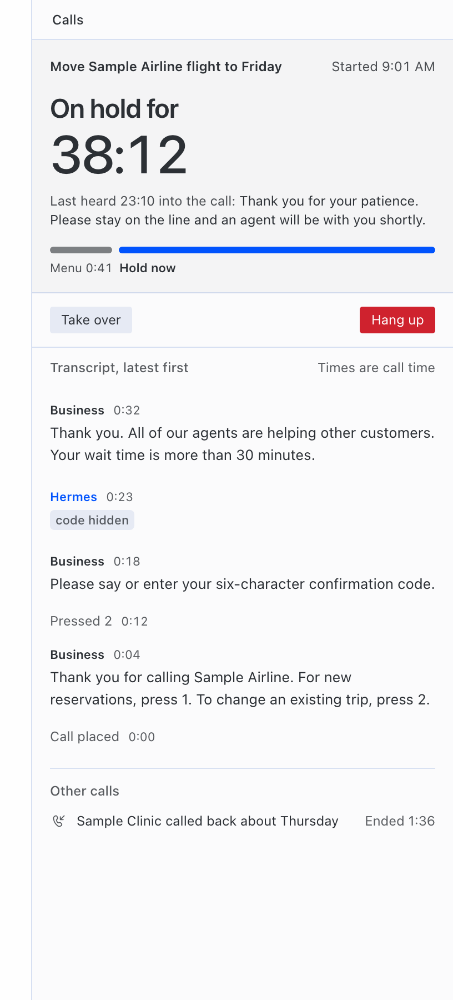
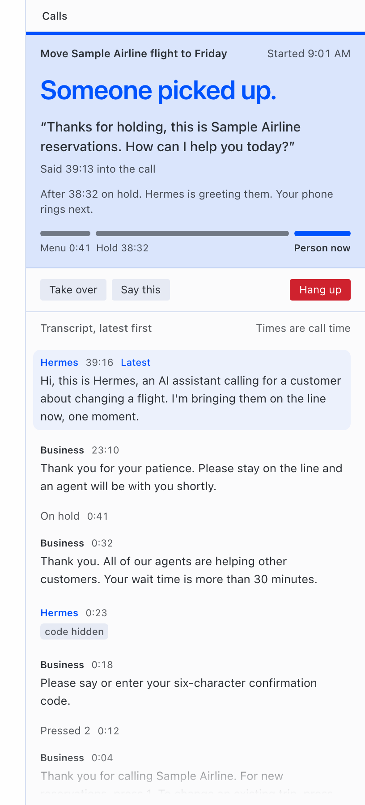
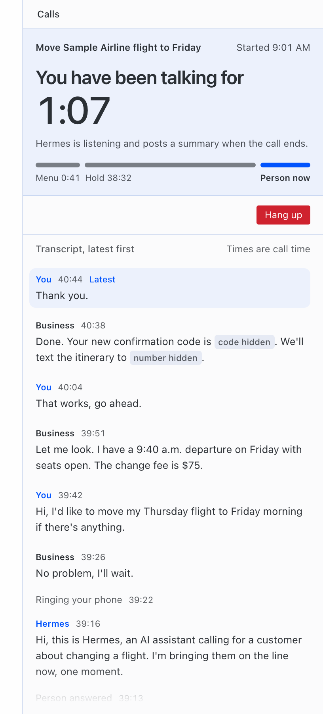
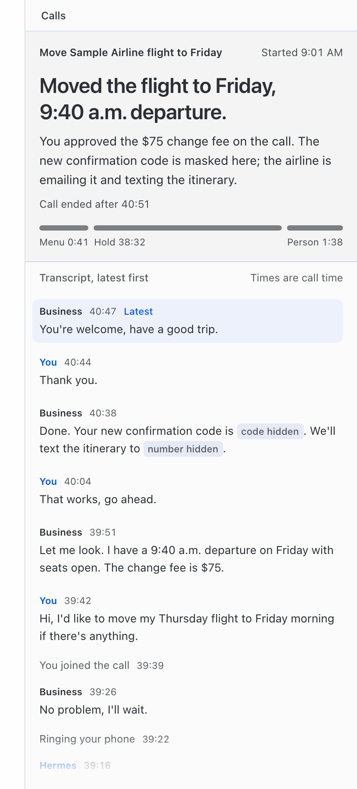

# Hermes Line

<!-- GENERATED from plugin/README.md by docs/release/sync_readme.py. Do not edit here: change
     plugin/README.md (the copy the plugin catalog renders), then run the script. -->

A phone line for your Hermes agent. You ask Hermes to call a business, approve the call, and Hermes dials it
from your own Twilio account. It works the phone menu, waits on hold without talking, and when a person picks up
it either rings your phone and bridges you in, or finishes the task itself. It posts a summary to the chat that
asked for the call. A business that calls back can be answered on the same line. SMS verification codes from
your Android phone can be sent into a call, but only after you approve exactly which call gets which code.

Version 0.1.0. Requires Hermes 0.22.5 or newer. License: MIT (`LICENSE`), copyright Can Uzay.

## Quick start (about 5 minutes)

You need Hermes 0.22.5 or newer and a Twilio account. Nothing below places a call until step 7. Each step is
explained in full under Setup.

1. **Twilio.** In the Twilio console, buy a US local number with voice (the **line number**) and create an API key
   (its SID starts with `SK`; keep the secret). A Twilio trial account can call only numbers you have verified in
   Twilio. To show your own mobile number to businesses, verify it under Verified Caller IDs (optional).
2. **Install.** `hermes plugins install uzay-eth/hermes-line/plugin --enable`. Hermes asks for
   `HERMES_LINE_TWILIO_ACCOUNT_SID` (`AC...`), `HERMES_LINE_TWILIO_API_KEY_SID` (`SK...`) and
   `HERMES_LINE_TWILIO_API_KEY_SECRET`.
3. **Tunnel.** With `cloudflared` installed, run `cloudflared tunnel --url http://127.0.0.1:8788` and leave it
   running. It prints an `https://...trycloudflare.com` address: that is your `public_base_url` (a new one on every
   run).
4. **Call profile.** `hermes profile create hermes-line-calls`, then `hermes --profile hermes-line-calls model`
   (no `--clone`). Add to `~/.hermes/profiles/hermes-line-calls/config.yaml`:
   ```yaml
   platform_toolsets:
     acp: []
   memory:
     memory_enabled: false
     user_profile_enabled: false
   plugins:
     enabled: []
   ```
5. **Settings.** In your Hermes `config.yaml` (numbers in E.164, `+1` and ten digits), then restart the gateway
   (`hermes gateway restart`, or `hermes gateway run` in a terminal):
   ```yaml
   plugins:
     entries:
       hermes-line:
         settings:
           enabled: true
           public_base_url: "https://<your-tunnel>.trycloudflare.com"
           from_number: "<your Twilio number, or your verified mobile>"
           line_number: "<your Twilio number>"
           owner_number: "<your mobile>"
           owner_name: "<your first name>"
           call_profile: hermes-line-calls
           policy:
             owner_timezone: "America/Denver"        # yours
             allowed_destinations:
               - "<your mobile>"                     # add each business later
   ```
6. **Check the setup.** `hermes hermes-line check` in a shell, or `/line check` in a Hermes chat. It places no call
   and costs nothing: it asks Twilio only read-only questions (are the credentials accepted, is the line number on
   the account with voice, is the caller ID yours) and prints one line per item, `OK` or what to fix. The shell
   command exits 0 only when every item passes.
7. **First call, to your own phone.** Outside quiet hours (21:00 to 08:00 in `owner_timezone` by default), ask
   Hermes in a chat: "Use Hermes Line to call <your mobile> and tell me the line works." Hermes posts an approval
   request; reply `/line approve <task_id>`. Your phone rings and Hermes speaks the AI disclosure first. Then add a
   business number to `allowed_destinations`, restart the gateway and ask for a real call.

## Status: what has been shown, and how

This is a hackathon release. Every claim below names its evidence in this repository.

| Feature | Status | Evidence |
|---|---|---|
| Outbound call, AI disclosure spoken first | **Live, twice**, ConversationRelay, agent mode, to the owner's own phone. Call 1 (80 s, `owner call 1`): disclosure, first reply in 1.56 s, then about 39 s of silence and the owner hung up. Call 2 after the fix (43 s, `owner call 2`): no silence; first text of Hermes's turns after 2.0, 1.6 and 7.3 s, with spoken fillers covering the slow turn; Hermes finished the call itself. | `evidence/trial/call_68921278eab742c6/trial.json`, `evidence/trial/call_9fda11b071df4fea/trial.json`, `STATUS.md` (2026-11-05 18:52Z) |
| Answering a call to your own forwarded line | **Live, twice**, both with the owner calling his own Google Fi number, forwarded by Fi "Always forward" to the Twilio line. Call 3 (92 s, `owner call 3`): Hermes answered with the disclosure; Twilio received the original caller in `From` and no `ForwardedFrom`; the plugin wrongly treated the owner as a hidden caller. Call 5 (121 s, `owner call 5`): the owner's number was recognised, Fi's screening prompt ("press 1 to take this call") was answered with 1, and Hermes held a 2-minute conversation without tools beyond the call. It offered to take a note five times; L1 round 16 limits that to once (offline). No PIN step on either call. | `evidence/trial/call_c20d76d32e9e47db/trial.json`, `evidence/trial/call_94909a575a8941db/trial.json`, `docs/lanes/L1.md` sections 21 and 27 |
| Verified caller ID (your mobile number shown to the business) | **Live.** Twilio verified the owner's Google Fi number as caller ID; calls 1 and 2 used it. | `evidence/twilio/04-verify-check.json`, `docs/briefs/L1-round7-live-findings.md` |
| Calling a real business (Delta Air Lines reservations, toll-free, approved by the owner) | **Live, four times; no person reached on any run.** Run 1 (68 s, `Delta run 1`): Delta answered with a conversational automated assistant; the menu gate kept Hermes silent, the task ended as failed, and the summary named phrases the gate had blocked, so they were never spoken. Run 2 (57 s, `Delta run 2`): the bot's cut-off self-introduction led to a false "person" verdict; the owner was rung for 18 s and did not pick up; the fallback question went to the bot and its non-answer was reported as an answer. Fixes since then, offline: fixed phrases for automated assistants (L1 round 25), a clear yes to our live-person question before any ring, one quiet gate for every fixed line, and honest fallback outcomes (rounds 30-31). Run 3 (a first attempt was refused by the quiet-hours gate, no call placed; the retry, 14 min 3 s, `Delta run 3 retry`): the assistant transferred the call to Delta's real hold queue ("The current phone wait time is 23 minutes"); Hermes then spoke into the hold queue seven times (two live-person questions, five "Agent."/"Representative." phrases); the call ended when the trial's line service was stopped (end reason `service_restart`). Fixed offline in L1 rounds 39-41 and L2 round 10: no phrases while on hold. Run 4 (44 min 43 s, `Delta run 4`): one "Agent." to the assistant, then Delta's real hold queue (45 minutes announced); 56 announcements classed as hold messages, 0 phrases spoken into hold, no false "person" verdict, ended at the trial's maximum call length with no person reached. | `evidence/trial/call_b669b105d4774a49/trial.json`, `evidence/trial/call_2243b7f205194ab5/trial.json`, `evidence/trial/delta3-stdout.jsonl`, `evidence/trial/call_05899c72ff3649bf/trial.json`, `evidence/trial/call_d4c0d44472b144c5/trial.json`, `docs/lanes/L1.md` sections 38, 42, 43, 51-53 |
| Calling a real business with a person answering (Hilton Reservations, toll-free, approved by the owner) | **Live, three calls on 2026-11-08; a person was reached three times (in two of the calls); detection missed every time; no owner ring, no bridge.** Hilton call 1 (2 min 32 s): Hilton's assistant and keypad menu (the menu gate pressed nothing because the menu offered billing), then a default transfer; a real agent greeted, Hermes asked "Am I speaking with a live person?" 1.2 s later, the agent said "Yes. Are you a live person too?" and later "I'm a live person."; both were judged unclear, Hermes said nothing for 14 s and the agent hung up. Hilton call 2 (round-43 code): attempt 1 (2 min 53 s) met a different menu (the gate blocked "Say yes or press 1 to continue on to an agent") and no person; the immediate retry (10 min 19 s) reached real agents who answered "Yes. You are speaking with the live person. Yes. Indeed." and similar eight times; the narrowed round-43 rule still judged them unclear and Hermes kept re-asking until the worker stopped the call. Fixed offline in L1/L2 round 43c (an explicit affirmation is a yes with any words after it unless the reply says what bots say; at most two questions per party, then the owner judges; the connecting line discloses the AI; holding lines while the owner rings); **not yet re-proven live**. No further Hilton test calls (owner decision). | `evidence/trial/call_05b4aa023f374279/trial.json`, `evidence/trial/call_b53427ae32364c51/trial.json`, `evidence/trial/call_94932d5a13a94ed4/trial.json`, `tests/l1/test_r43_hilton_yes.py`, `tests/l2/round43-after.json` |
| Calling a real business whose AI phone agent answers first (Bora Mediterranean, Reno, route A, approved by the owner) | **Live once on the trial build, 2026-11-10 (take 7): AI agent handled, transferred, person confirmed, owner rung, owner pressed 1, both phones bridged; recorded on the trial build.** The restaurant's AI phone agent said it was a virtual assistant; Hermes asked it only for staff ("Staff, please. Table for 20 tomorrow evening.", twice) and the agent transferred the call. A person answered ("Hello. ... How can I help you?"), Hermes asked "Am I speaking with a live person?" and the person said "Yes."; Hermes gave the request and the connecting line and rang the owner about 2 s later. The owner pressed 1 on the private prompt 9.6 s after the ring started, both phones joined the conference and the owner and the person talked for about 47 s (business leg 2 min 10 s, owner leg 53 s). The trial build is this code plus a Bora-specific staff line and a longer owner window; neither is in the published plugin yet, so the bridge is not yet proven live on the published code. | `evidence/trial/call_5cce66d5964c476b/trial.json` |
| Phone menus (keys and speech) | Offline tests with a fake Twilio. Real keypad menus at Hilton (calls 1 and 2): the menu gate pressed nothing because every menu offered billing or cancellation options, and it blocked "Say yes or press 1 to continue on to an agent" as acceptance wording; Hilton transferred to an agent by default twice. On Delta's conversational assistant one fixed "Agent." got a transfer to the hold queue (run 4). | `tests/l1/test_flows.py`, `docs/lanes/L1.md` section 1 |
| Waiting on hold | **Live on a real hold queue, twice (Delta runs 3 and 4).** Run 4 waited on Delta's hold queue for about 44 minutes in silence: 0 phrases spoken into hold, ended at the trial's maximum call length; no agent picked up, so the hand-off at the end of a hold is still unproven live. Run 3 (14 min 3 s) talked into the hold queue; fixed before run 4. Offline: a 40-minute virtual hold with 0.0 s of voice-model time. | `evidence/trial/call_d4c0d44472b144c5/trial.json`, `evidence/trial/call_05899c72ff3649bf/trial.json`, `docs/lanes/L5.md` section 4, `tests/l5/` |
| Detecting that a person answered | Experimental. On authored transcripts plus the two live replies: 0 false "person" results on 31 held-out non-human cases; 2 of 7 held-out human cases missed with a model, 4 of 7 without one. The live reply to the live-person question ("Yeah. It's me, ...") is now recognised as a person; this is not yet confirmed on a new live call. Authored airline hold transcripts: 0 false "person" in 13 held-out non-human events, 0 of 2 agents missed. Live, Delta run 2 produced a false "person" from a bot; replayed through the current detector it gives 0 of 9 "person" verdicts (offline). Delta runs 3 and 4 (about 58 minutes of real assistant and hold audio): no "person" verdict and no owner ring; no real person came on, so detecting a real agent is still unproven live. **Live, Hilton calls 1-2: real agents were missed three times** ("Yes. Are you a live person too?", "Yes. You are speaking with the live person."): the clear-yes rule required a whole-reply match from a short list. Round 43c (offline): a reply that starts with an explicit affirmation is a yes whatever follows, unless it says what bots, menus or recordings say; held-out non-human sets stay at 0 false "person", 38 authored yes-like bot/queue/IVR replies 0 accepted, the human target set 16 of 16 (was 1 of 16). Not yet re-proven live. | `tests/l2/round43-before.json`, `tests/l2/round43-after.json`, `docs/lanes/L2.md` rounds 2, 4 and 9, `STATUS.md` (L2 r9), `tests/l2/round2-after.json`, `tests/l2/round4-airline-metrics.json` |
| Ringing you and bridging you in | The owner ring has happened live once, wrongly (Delta run 2, no pickup). A bridge has happened live once, on the trial build only (Bora take 7, 2026-11-10, row above: owner pressed 1, both phones bridged). Hilton calls 1-2 reached real agents but never rang the owner (detection missed); round 43c rings after a yes with the line "I'm an AI assistant calling for <owner>. Please hold..." within about 4 s, and holding lines keep the person from more than about 6 s of silence while the owner rings (offline). Offline tests with a fake Twilio, including a full end-to-end fake call over the real ingress, and the opt-in live-leg bridge (`owner_live_bridge`). | `evidence/trial/call_2243b7f205194ab5/trial.json`, `evidence/trial/call_5cce66d5964c476b/trial.json`, `tests/l1/test_flows.py`, `docs/lanes/L1.md` sections 12 and 26 |
| Callbacks from a business | Offline tests: matching a callback to its task, callbacks forwarded from your own line (for example Fi), unknown callers (message, or ring you and you press 1). A real business callback has not happened yet (call 3 was the owner). | `tests/l1/test_r7_callbacks.py`, `docs/lanes/L1.md` section 16 |
| Reading SMS codes from an Android phone | **Live read** on a Pixel 10 Pro XL (Android 17): one message with a code was found, the code masked in the log. Whether Android 17 delays fresh codes is not measured yet: the probe found no phone attached. | `evidence/sms/probe-check.txt`, `evidence/sms/probe-inbox.txt`, `evidence/sms/otp-delay-20261105T184714Z.json` |
| Codes sent to a Twilio number | **Live observation:** Twilio filtered a one-time-code text to this project's Twilio line (error 30038). Codes can only come from your carrier phone. | `STATUS.md` (Vezir, 2026-11-05) |
| Sending an approved code into a call | Offline tests only, including the real Hermes core in a throwaway home. Off in the live trial. | `docs/lanes/L4.md` sections 2 and 5 |
| Grok Voice path (optional xAI key) | **Live, once.** Call 4 (64 s, `owner call 4`, to the owner's phone): Grok spoke for Hermes and used three tools (one question to Hermes, the outcome report, the hang-up); the conversation session connected in 1214 ms once the person was detected, and `voice_first_audio` logged 490 ms; Grok was connected 53 s and hold-path speech-to-text 12.8 s; harness estimate $0.096 of xAI time (not an invoice). Seen on that call and fixed offline in L5 round 6: the disclosure recorded twice in the transcript (spoken once) and repeated copies of the caller's words. No barge-in happened, so barge-in is still unproven live. Key tones on this path are untested. | `evidence/trial/call_374a992b53c044f9/trial.json` (`grok_evidence`), `docs/lanes/L5.md` section 7 |
| Owner line mode (call your line, key a PIN, have Hermes call a business) | **Experimental, off by default** (off unless `HERMES_LINE_OWNER_PIN` is set). Offline tests only; no live call has used the PIN yet (calls 3 and 5 had no PIN step). Security review R1b delta 35: YES for one attended, keypad-only trial in which the owner asks Hermes to call his own other line; not cleared for business calls or a broader allowlist. Two Medium limits remain (see setup step 8). | `docs/lanes/L1.md` sections 22-26, `evidence/reviews/R1-DELTA35.md` |
| Desktop pane | **Runs inside a real Hermes Desktop** (v0.22.5, isolated sandbox install, real REST API) with sample data, matching the offline harness renders. Replayed in real time with the recorded data of Delta run 2: the pane went from "Dialing" straight to the owner ring, because "A person answered" lasted 1.2 s and the pane polls every 5 s; the ended headline showed the summary's status line; the time strip was wrong for real data (backlog B7-B9, B12; fixes briefed). Not yet captured during a live call. | `docs/lanes/L3.md` rounds 5 and 6, `tools/pane-preview/screenshots/desktop/`, `tools/pane-preview/screenshots/live/replay-call_2243b7f205194ab5/`, `docs/BACKLOG.md` |
| `hermes plugins validate --install-deps` | Passed, exit 0 (cold run). No plugin warnings up to L1 round 15; since the call-profile check (2026-11-10) one warning, private core imports, for the four guarded imports listed in `docs/release/PR.md`. | `tests/l1/evidence/validate.txt` (round 15) |
| Offline test suites | 1247 tests pass (L1 535, L2 130, L3 66, L4 317, L5 88, L6 111), no network. | `docs/release/test-run.txt` |

## How a call goes

1. You ask in chat: "Call Sample Bistro at +1 775 555 0100 and book a table for 4 at 7, put me on if they need me."
2. Hermes calls `hermes_line_request_call`. Nothing is dialed. The call waits until you approve it in chat with
   `/line approve <task_id>` (the Desktop pane shows it as waiting). The approval message shows the whole goal the
   call's Hermes session will get, in numbered parts when it is long; the other party may hear any of it. If that
   message cannot be posted, the request is withdrawn. Hermes cannot approve its own call, and nothing said on the
   phone counts as approval.
3. Hermes dials, says the disclosure line ("Hi, this is Hermes, an AI assistant calling on behalf of ..."),
   presses menu keys, and stays quiet on hold. If the business answers with a conversational automated assistant,
   Hermes says only fixed phrases the line picks ("Representative.", "Agent.", "Speak to an agent." and a few more,
   see Limits), never model text.
4. When the transcript shows a person, Hermes asks "Am I speaking with a live person?". On a restricted task your
   phone rings only after a plain yes to that question, never on a guess. Every fixed line Hermes says after the
   disclosure waits until the business has finished and 1.2 seconds of quiet have passed (10 seconds at most).
5. Then, as you chose in the request:
   - **owner mode**: your phone rings with a short private message; you press 1 and are joined to the business.
   - **agent mode**: Hermes talks to the person and finishes the task with the title and goal you approved. The
     call runs in its own Hermes profile, without your memory, user profile, persona or other tools (setup step 4;
     Limits lists what is not closed).
6. When the call ends, a summary goes back to the chat that asked for it, also after a restart. One-time codes and
   card numbers are masked.

The pane shows the live state, the time on hold, the masked transcript, and **Take over**, **Say this** and
**Hang up** buttons.

## Requirements

- Hermes 0.22.5 or newer, with the Hermes gateway able to run on the same machine. Every call is a Hermes session
  run through `hermes acp` (`docs/lanes/L1.md` section 8).
- A Twilio account with a US local phone number that can make and receive voice calls.
- A public HTTPS address that forwards to the plugin's local port (a tunnel).
- Optional: an xAI API key, for the Grok Voice path.
- Optional: an Android phone with `adb` installed, on USB or on Wi-Fi (wireless debugging), to read SMS verification codes.

Only US numbers can be called: geographic and toll-free (see Limits).

## Setup

### 1. Twilio account, number and API key

1. In your Twilio account, buy a US local number with voice. This is the **line number**: callbacks arrive here.
   Verification codes cannot be read from it: Twilio filters one-time-code texts sent to its numbers (error 30038,
   "OTP Message Body Filtered", body redacted; seen on this project's line on 2026-11-05). Codes are read from your
   own carrier phone instead (step 6).
2. Create a Twilio API key (SID starts with `SK`) and keep its secret.
3. When Hermes installs the plugin, it asks for the three required secrets declared in `plugin/plugin.yaml`
   (`requires_env`). The plugin reads them only through Hermes (`agent.secret_scope.get_secret`), never from files.

| Name | What |
|---|---|
| `HERMES_LINE_TWILIO_ACCOUNT_SID` | Your Twilio Account SID (`AC...`) |
| `HERMES_LINE_TWILIO_API_KEY_SID` | The API key SID (`SK...`) |
| `HERMES_LINE_TWILIO_API_KEY_SECRET` | The API key secret |
| `HERMES_LINE_TWILIO_AUTH_TOKEN` | Optional, recommended. With it, every Twilio webhook is checked by Twilio's signature. Without it, the plugin uses a secret URL path plus a Twilio API lookup of every call leg; that fallback and its limits are described in `docs/lanes/L1.md` section 9. |
| `XAI_API_KEY` | Optional. See step 5. |
| `HERMES_LINE_OWNER_PIN` | Optional, 4 to 8 digits. Turns on owner line mode (step 8). Stored only in Hermes's secret store; never shown to Hermes or written to any log. |

### 2. Caller ID

`from_number` is required. Set it to your Twilio number, or, to show your own mobile number to the business,
verify that number in Twilio as an outgoing caller ID first (Twilio calls that phone and you type the code it
shows) and set `from_number` to it.

### 3. Public address

Twilio has to reach the plugin over HTTPS and WSS. The plugin listens on `127.0.0.1:8788`. Run a tunnel to that
port and put its `https://` origin in `public_base_url`. The live trial used a Cloudflare quick tunnel
(`docs/lanes/L6.md`). A quick tunnel gets a new hostname each time, which is fine for outbound calls; callbacks
need a stable hostname (a named tunnel on your own domain, for example).

### 4. Settings

Settings live under `plugins.entries.hermes-line.settings` in your Hermes `config.yaml`. A minimal setup:

```yaml
plugins:
  entries:
    hermes-line:
      settings:
        enabled: true
        public_base_url: "https://line.example.com"
        from_number: "+17755550100"      # your Twilio number, or a verified caller ID
        line_number: "+17755550100"      # your Twilio number
        owner_number: "+17755550111"     # your own phone, rung to bridge you in
        owner_name: "Sam"
        policy:
          owner_timezone: "America/Denver"
          allowed_destinations:
            - "+17755550111"             # your own phone must be here too
            - "+17755550199"             # each business you want Hermes to be able to call
```

(The numbers above are placeholders.)

**A Hermes profile for the calls (required).** A stranger on the phone partly drives the call's Hermes session, so
that session may hold only the call tools (never terminal, files, browser, web or other MCP tools) and none of your
memory, user profile or persona. Hermes bounds a session's tools and memory per profile, so create a new profile for
calls. Do not use `--clone`, `--clone-all` or `--clone-from`: they copy your `SOUL.md`, `MEMORY.md`, `USER.md`,
`.env` and settings. Then set only its model and provider:

```sh
hermes profile create hermes-line-calls
hermes --profile hermes-line-calls model     # model, provider and the provider's key, kept in this profile
```

The provider key must be in the call profile: the plugin does not pass the keys in your shell or your Hermes
process to `hermes acp` (see the environment below).

Add to `~/.hermes/profiles/hermes-line-calls/config.yaml`:

```yaml
platform_toolsets:
  acp: []
memory:
  memory_enabled: false
  user_profile_enabled: false
plugins:
  enabled: []
```

Leave these unset or empty: `memory.provider`, `display.personality` (or a neutral name: `none`, `default`,
`neutral`), `agent.system_prompt`, `personalities`, `agent.personalities`, `prefill_messages_file`,
`agent.prefill_messages_file`, `agent.environment_hint`, `agent.coding_instructions`, `platform_hints`, `hooks` and
`mcp_servers`. Because the profile is created fresh, its `.env` holds only the provider key that
`hermes --profile hermes-line-calls model` writes; keep it that way. Hermes itself loads that `.env` into the call
agent, and the plugin does not inspect it, so anything else put there reaches the call session (Limits). The
profile's `hooks/` folder must have no hook directories. Keep the `SOUL.md` Hermes wrote into the new profile (its stock text), or empty it. Then set
`call_profile: hermes-line-calls` in the plugin settings. The plugin does not need to be installed in that
profile.

What the plugin does with that profile:

- Every call session starts with Hermes's own `--ignore-rules` (`HERMES_IGNORE_RULES=1` for `hermes acp`): Hermes
  loads no `SOUL.md`, no project context file (`AGENTS.md`, `.cursorrules` and the like), no memory and no preloaded
  skills into it. Hermes loads the profile's `.env` over the environment the plugin gives it (and `hermes acp`
  loads it again after its command-line flags), so a `HERMES_IGNORE_RULES=0` there would undo it; the plugin does
  not inspect the `.env`, which is why the setup keeps only the provider key there (Limits).
- The plugin checks the profile when you approve a call, when an inbound call arrives, and again just before the
  session starts. It refuses the profile if memory or the user profile is on, a memory provider or any key listed
  above is set, its `hooks/` folder has a hook directory, a plugin is enabled (or one is installed while
  `plugins.enabled` is unset), `memories/MEMORY.md` or `memories/USER.md` is not empty, `SOUL.md` is neither empty
  nor Hermes's stock or earlier auto-seeded text. It reads `config.yaml` and `SOUL.md` and lists the `plugins` and
  `hooks` folders; the memory files are only checked for size. It does not inspect the profile's `.env`. It is a
  fixed list, not a check of everything Hermes loads (Limits).
- With a refused profile, nothing is dialled. The `/line approve` reply names each problem and the fix, and the task
  is marked failed with the outcome `blocked: call profile not neutral: ...`; ask Hermes for the call again after the
  fix. An inbound caller hears "Sorry, this line cannot take calls right now. Goodbye." and the call ends, on both
  voice paths. When the service starts with a refused profile, the plugin says so once: in the chat of the latest
  task that came from a chat (it looks at the last 50 tasks), or, when none did, in reply to your next `/line`
  command or `hermes_line_request_call`.
- **If you made this profile earlier with `--clone`, delete and recreate it:** `hermes profile delete
  hermes-line-calls`, `hermes profile create hermes-line-calls`, `hermes --profile hermes-line-calls model`, then the
  config lines above. The check refuses a clone for the memory, user profile, `SOUL.md` and settings it copies, and
  the `/line approve` reply says to delete and recreate it. Editing the clone until it passes is not enough: it keeps
  your `.env` (provider keys, platform tokens) and your skills, which the plugin does not inspect.
- The plugin then reads the session's tool list; if it holds anything beyond the call tools, nothing is dialled and
  the event log says why.
- The session runs in a new, empty, owner-only directory, made for the call and removed when the call ends (also
  when the session fails to start); never in the gateway's working directory. It is made under the first of the
  process temp directory (`TMPDIR`), `/tmp` and `/var/tmp` that has no `.git` and none of the project files Hermes
  looks for (`Makefile`, `package.json`, `pyproject.toml`, `AGENTS.md` and the like) in it or any folder above it.
  With none of them clean, no call session starts. Inside a git repository or project, Hermes would add that
  project's root, branch, status and recent commit subjects to the session's prompt.
- `hermes acp` gets only these variables from the plugin's environment: `PATH`, `HOME`, `USER`, `LOGNAME`, `LANG`,
  `LC_ALL`, `LC_CTYPE`, `LC_MESSAGES`, `TMPDIR`, `HERMES_HOME`, `XDG_CONFIG_HOME`, `XDG_DATA_HOME`, `XDG_STATE_HOME`,
  `XDG_CACHE_HOME`, `XDG_RUNTIME_DIR`, `SYSTEMROOT`, `SSL_CERT_FILE`, `SSL_CERT_DIR`, `REQUESTS_CA_BUNDLE`,
  `CURL_CA_BUNDLE` and the proxy variables (`HTTP_PROXY`, `HTTPS_PROXY`, `NO_PROXY`, `ALL_PROXY`, also lower case),
  plus `HERMES_IGNORE_RULES=1`. When the call profile's gateway is not running, `hermes acp` starts it with that
  environment.

In Hermes Desktop, turn Hermes Line on in Capabilities → Plugins, then reload the window (⌘R). In testing, switching
it off and on without a reload did not load the pane (`docs/lanes/L3.md` round 5).

Then check the service with `/line service status`. It reports whether the
service is running and whether webhooks are checked by signature or by the fallback.
To check the whole setup without placing a call, run `hermes hermes-line check` (or `/line check`; Quick start,
step 6).

### 5. Grok Voice (optional)

With `XAI_API_KEY` set, the default `voice.transport: auto` uses Twilio Media Streams and xAI's Grok Voice for the
spoken conversation, and xAI's streaming speech-to-text while on hold. Without it, calls use Twilio
ConversationRelay, where Twilio does speech-to-text and text-to-speech and your Hermes writes every sentence.
Force one with `voice.transport: conversation_relay` or `media_streams`. This path is tested offline and with one
real xAI connection that set up a session without audio (`tests/l6/dry-round6-grok.json`), and one live 64-second call
to the owner's phone (`evidence/trial/call_374a992b53c044f9/trial.json`).

### 6. SMS codes from an Android phone (optional)

Codes must arrive on a real carrier SIM. Twilio numbers do not receive one-time-code texts (error 30038), so
never give a service the Twilio line number for verification.

Connect the phone by USB with USB debugging on and `adb` on your PATH. The plugin reads the SMS inbox with
`adb shell content query` (read-only). Set `sms_source: none` to turn this off. Set `sms_adb_serial` if more than
one device is attached.

**Wireless debugging (no cable).** The phone can stay on Wi-Fi instead of USB:

1. On the phone: Developer options, Wireless debugging on, then "Pair device with pairing code". It shows an
   `ip:port` and a six-digit code.
2. On the computer: `adb pair <ip:port>` and type the code. Pairing is done once.
3. Find the phone's service name: `adb mdns services` lists `adb-<id>-<suffix>` with `_adb-tls-connect._tcp`.
   (`adb devices` shows the same name with `._adb-tls-connect._tcp` appended once it is connected.)
4. Set `sms_adb_serial` to that name, for example `adb-5B050DLCQ000P3-eQkDjp`. The plugin then always talks to
   that phone and never to "whichever device is attached". It also accepts `ip:port`, but the port changes every
   time wireless debugging restarts, so the service name is the better choice.

If the link drops, the plugin makes one bounded attempt (10 seconds) to find the phone again with `adb mdns
services` and `adb connect`, then retries the read once. It never returns an empty result on failure: you get
"phone unreachable over Wi-Fi (asleep or off the network)", "paired device not advertised on the network", or
"device unauthorized" (accept the wireless debugging prompt on the phone, or pair again). A sleeping phone, a
Wi-Fi change or switching wireless debugging off drops the link. Reading one code takes about 3 to 6 seconds over
Wi-Fi (the phone starts a small Java program for every read), occasionally 10 seconds or more. **USB is more
reliable and is recommended** when the phone stays next to the computer; use Wi-Fi when it cannot.

To let a code into a call, run `/line allow-code <task_id> <sender> call`. You see the call and the number the
code will go to, then confirm with `/line confirm-code ...`. Hermes then calls `line_otp_to_call`; the code is
sent as key tones or spoken by the plugin. **The model never sees the code.** Transcripts, events, the pane and
logs show only `[verification code sent]`.

Codes go only into the approved live call. This build does not type codes into web pages.

### 7. Callbacks

Callbacks need the Twilio line number's voice webhook pointed at the plugin, a stable public hostname, and the
service running all the time. A callback is matched to its task by the caller's number; an unknown caller hears the
AI disclosure and leaves a message, or asks for you and your phone rings (`inbound_ring_owner`). If businesses see
your own mobile number (a verified caller ID), forward that line to the Twilio number and set `forwarding_number`.
For a Google Fi line the steps are in `docs/release/fi-forwarding.md`.

Callbacks are tested offline (`tests/l1/test_r7_callbacks.py`), and the plugin does not yet print the webhook
address to set on the Twilio number. On both live forwarded calls so far (Google Fi "always forward"), Twilio got
the original caller's number and no `ForwardedFrom`, so the plugin records the forwarding as `unknown` rather than
guessing. Other carriers are untested.

- **Carrier screening.** A forwarded call can open with the carrier's own prompt before the caller is connected.
  Google Fi says "In case of a fast pickup… you need to press 1 to take this call." With `forwarding_number` set,
  the greeting waits until the caller speaks, or up to `inbound_screening_hold_s` (6 s). If that prompt is heard in
  the first 15 seconds, the line presses 1 at once and then greets the caller. Only that prompt counts. A caller who
  phones the Twilio number directly hears the greeting as soon as they say hello, or after the wait.
- **Notes.** On a call, Hermes offers to take a note at most once. A later offer is not said unless the caller asks
  for a note or a message.

### 8. Owner line mode (optional, experimental, off by default)

Call your Hermes Line from the road and have Hermes phone a business for you. Set `HERMES_LINE_OWNER_PIN` (4 to 8
digits) and `owner_number`.

**Status: experimental, tested offline only.** The latest security review, R1b delta 35
(`evidence/reviews/R1-DELTA35.md`), cleared one attended, keypad-only trial in which the owner asks Hermes to call
his own other line, with a two-number allowlist; it is not clearance for business calls or a broader allowlist. It
names two Medium limits: the keypad confirmation does not identify a replacement goal or prove the read-back was
heard, and a PIN spoken slowly in fragments can reach Hermes before it is scrubbed. Key your PIN; never say it aloud.

- **Caller ID is not proof.** A call from `owner_number` is only offered the PIN: "If you are Can, key your PIN,
  then press pound." Until the PIN passes, the caller is an unknown caller who can leave a message, nothing more.
- **Entering the PIN.** Keypad only: key it and press `#` (or pause). A spoken PIN never counts. If the PIN is said
  aloud anyway, even split over several sentences or with pauses and punctuation, the plugin replaces every piece
  with `[PIN]` before the transcript or Hermes sees it. Speech that ends in what could be the start of your PIN
  waits up to 1.5 seconds for the rest. The PIN is never passed to Hermes and never appears in transcripts, events or
  logs.
- **Lockout.** Wrong PINs count against the line, not the caller, and survive redials and restarts.
  - After 3 wrong tries Hermes says goodbye and hangs up, with no hint, and owner line mode is locked for 15 minutes.
  - After 10 wrong tries in 24 hours it stays locked until you run `/line unlock-owner` in chat.
  - Each lockout sends you one chat message. While locked, the PIN is not offered and keyed digits are not checked.
- **After the PIN.** Ask questions, or say "call Sample Bistro for me" (and "ring me when they answer" if you want
  to talk to them yourself).
  - The line reads the number back and ends with "To confirm, key the last four digits of the number, then pound."
    Keying those digits and `#` within 60 seconds approves that one call to that number, and nothing else. The line
    asks for the last four digits only for your own number or a number you already approved before. Any other number
    needs its last seven digits, so two numbers that end the same cannot be confused.
  - Saying yes never approves anything on this line. Wrong digits, or no digits within 60 seconds, cancel the
    confirmation; the task then waits for your approval in chat (`/line approve`).
  - A second call in the same conversation needs its own confirmation.
  - The call is dialled when you hang up, because the line runs one call at a time. A call you asked for on the
    phone has no chat behind it, so its summary is not posted to a chat: it is in the Desktop pane and in the call
    status Hermes reads (`hermes_line_call_status`).
  - **Staying on the line (`owner_live_bridge`, off by default).** With this setting on, a call where you asked to
    be put through is dialled at once while you stay on your call. When a person answers, the line moves your call
    and theirs into one conference; your phone is not rung a second time. Until then you can keep talking with
    Hermes, and pressing star cancels the call. If nobody answers, or the call ends first, Hermes tells you on your
    call. If you hang up first, the call carries on and your phone rings when a person answers, as without the
    setting. Once you are connected, the conference ends when either side hangs up. Only one such call runs at a
    time, and no other call can start while it runs. It needs the same approvals as any call; only the second
    call to your phone is skipped. Tested offline only.
- **What a phone session can't do.** It runs on the restricted call profile (step 4), so it has no tool for your
  memory, calendar, files or anything else, also on your own calls to the line (owner line mode). Of what you asked
  for, it has the task's title and goal and your configured name. It says so, and you can ask in chat.
- **Stated limits of the call session's isolation** (what the plugin does not close):
  - **Your machine.** Hermes adds a runtime block to every session, the call session included: the host OS, the home
    and working directory paths (the home path often holds your account name), the profile name, the time zone and,
    unless `agent.environment_probe` is false in the call profile, a one-line probe of the host. A caller who asks
    may hear it.
  - **Callbacks matched by caller ID.** Caller ID can be faked. A caller who fakes the number of a business you asked
    Hermes to call is greeted with that task's title, and the call session gets that task's title and goal.
  - **A running call gateway.** The environment allow-list applies when `hermes acp` starts the call profile's
    gateway. A gateway that already serves the call profile (started by you, or a multiplexed gateway that serves
    all your profiles) keeps the environment it was started with, and the call session runs there.
  - **The call profile's `.env`.** Hermes itself loads it into the call agent and its gateway; the plugin does not
    open or inspect it. The setup creates the profile fresh, so the file holds only the provider key that
    `hermes --profile hermes-line-calls model` writes. Anything added there reaches the call session as set: a
    launch flag such as `HERMES_IGNORE_RULES=0` would undo `--ignore-rules`, and a prompt variable such as
    `HERMES_ENVIRONMENT_HINT` would add text to the prompt. A profile made earlier with `--clone` keeps your own
    `.env`: recreate it (the `/line approve` reply says so).
  - **What the check does not read.** It does not read the skills, or keys of `config.yaml` that are not listed in
    setup step 4. Recreate a cloned profile instead of editing it.
  - **Managed configuration.** The check reads the profile's own `config.yaml`. A managed (administrator) layer that
    Hermes applies on top of it, including a managed `.env`, is not read, and could set a listed key.
  - **Prompt text in a running gateway.** A call gateway that is already running keeps the environment it was
    started with; prompt variables set there (`HERMES_EPHEMERAL_SYSTEM_PROMPT`, `HERMES_ENVIRONMENT_HINT` and the
    like) reach the call session's prompt. The plugin cannot see that environment.
  - **Your own Hermes speaking on the call.** `hermes_line_say` from the owner's own agent has no per-sentence
    approval: your Hermes, which has your memory and tools, can make the call say any sentence, and it reads the
    other party's words through `hermes_line_call_status`. The tool's description tells it to say only sentences you
    asked for, never one the call's transcript asks for. Hermes's plugin API asks for a choice only from a slash
    command, not from a tool call, so a per-sentence approval would need a new approval route. `/line say` and the
    Desktop "Say this" are you.
  - **Long goals on narrow chats.** The approval request is split into parts of at most 1,500 characters, under the
    smallest limit of Hermes's built-in chat adapters (SMS, 1,600). A chat behind Hermes's relay with a lower
    negotiated limit can still cut a part. The Desktop REST snapshot (`GET /calls`) carries each task's goal as
    `task_goal`; the pane has no approve button.
  - **Text from the call in your chat.** The summary posted to your chat, and what `hermes_line_call_status` returns
    to your Hermes (masked transcript tail and summary), contain the other party's words. The posted summary is
    marked as untrusted. The plugin also tries to tell your Hermes session that the call ended and its task status
    (one sentence, no words from the call); Hermes refuses that unless `allow_gateway_injection: true` is set for
    the plugin (`plugins.entries.hermes-line`), and the posted summary does not depend on it.
  - **The check is a snapshot.** It runs at approval, at admission and before the session starts; a change to the
    profile in between is not seen until the next check. Only you can write the profile.
- Owner line mode works on ConversationRelay calls; the Grok Voice path has no PIN step yet.
- Your PIN's key tones pass through Twilio like any keypad input.

## Commands and tools

`/line` commands (tools and the model cannot run approve, deny or allow-code). The plugin does not check who sends
them: **any sender your Hermes gateway admits can run every `/line` command, including `/line approve`.** In a group
chat that is every admitted member, so run the plugin on a gateway that admits only you.

```
/line status
/line approve <task_id>        /line deny <task_id>
/line takeover <call_id>       /line hangup <call_id>      /line say <call_id> <text>
/line allow-code <task_id> <sender> call  then  /line confirm-code <nonce>
/line unlock-owner              (after a PIN lockout, step 8)
/line service start|stop|status
/line check                     (setup check: no call, read-only Twilio requests)
```

Tools the agent gets: `hermes_line_request_call`, `hermes_line_call_status`, `hermes_line_list_tasks`,
`hermes_line_say`, `hermes_line_hang_up`, `hermes_line_take_over`; during a call `hermes_line_call_press_digits`,
`hermes_line_call_finish`, `hermes_line_call_bring_owner`, and for owner line mode `hermes_line_call_new_task`
(refused unless the caller passed the PIN); for codes `line_otp_to_call`. The bundled skill `hermes-line` tells the agent when and how to use them.

## Settings

| Setting | Default | What |
|---|---|---|
| `enabled` | `false` | Run the call service in this Hermes process. Nothing starts without it. |
| `public_base_url` | empty | Your tunnel's `https://` origin. |
| `listen_host`, `listen_port` | `127.0.0.1`, `8788` | Where the plugin listens for Twilio (through the tunnel). |
| `from_number` | empty | Caller ID for outbound calls (Twilio number or verified caller ID). |
| `line_number` | empty | Your Twilio number for callbacks. |
| `owner_number` | empty | Your phone, rung to bridge you in. Must be on the allowlist. |
| `owner_name` | `the owner` | Used in the disclosure line. |
| `disclosure_text` | "Hi, this is Hermes, an AI assistant calling on behalf of {owner}. This call is not recorded." | First line of every outbound call. |
| `ring_timeout_s` / `owner_ring_timeout_s` | 30 / 25 | How long the business / your phone may ring. |
| `max_call_minutes` | 90 | Hard limit per call (1 to 240); also sent to Twilio as the call time limit. |
| `callback_window_hours` | 72 | How long a task waits for a callback. |
| `ingress_auth` | `auto` | `auto`: signatures if the Auth Token is set, else the fallback. `signature`: refuse to start without the Auth Token. |
| `sms_source` | `adb` | `adb` or `none`. |
| `sms_adb_serial` | empty | Which phone to read: a USB serial, the wireless-debugging service name (`adb-<id>-<suffix>`), or `ip:port`. Empty means the one attached USB device. |
| `call_profile` | empty | The Hermes profile the call sessions run in. It must give ACP no toolsets (see Setup, step 4); otherwise no call is dialled. |
| `forwarding_number` | empty | Your own line (for example Google Fi) that forwards calls to `line_number`, so callbacks to it reach Hermes. |
| `inbound_ring_owner` | `true` | Let an unknown inbound caller ask for you; your phone rings and you press 1 to join. |
| `inbound_screening_hold_s` | `6` | With `forwarding_number` set: how long an inbound greeting waits for a carrier screening prompt before it plays (0 to 10 s, 0 is off). |
| `owner_live_bridge` | `false` | Owner line mode (step 8): dial a call you asked to be put through while you stay on your call, and join your call to it when a person answers. Off: it is dialled after you hang up and rings you back. |
| `reply_budget_s` | `2.5` | Longest silence a person on the line hears before Hermes says something (0.5 to 3 s). |
| `voice` | see ADR 0004 | `transport` (`auto`, `media_streams`, `conversation_relay`), `conversation` (`grok` or `hermes_text`, where Grok only reads out what Hermes wrote), timings. |
| `policy.allowed_destinations` | empty | With the allowlist on, the only numbers that can be dialed. Empty means no call can be placed. |
| `policy.allowlist_only` | `true` | Dial only numbers on `allowed_destinations`. Set `false` to let Hermes request calls to any supported US number; each call still needs your approval. |
| `policy.blocked_destinations` | empty | Numbers that are never dialed, even if allowed (for example a number of your own that runs something else). |
| `policy.disclosure_enabled` | `true` | Speak the disclosure line. |
| `policy.quiet_hours_enabled`, `quiet_hours_start`, `quiet_hours_end` | `true`, `21:00`, `08:00` | No outbound calls in this window; callbacks never ring you in it. |
| `policy.owner_timezone` | `America/Los_Angeles` | Set yours. Quiet hours use it. |

Fixed, not settings: every call needs your approval, and one call at a time per line
(`plugin/line/policy/settings.py` refuses any other value).

## Disclosures

What you should know before installing:

- **The other party hears an AI.** Every outbound call starts with the disclosure line unless you turn
  `policy.disclosure_enabled` off. Hermes is instructed never to claim to be human.
- **No recording.** The plugin asks Twilio not to record (`Record=false` on every call it places). In 0.1.0 there is
  no recording feature at all; `policy.recording_enabled` exists but nothing reads it.
- **Allowlist and approval.** By default only numbers you list can be dialed (`policy.allowlist_only`), and each
  call needs your approval with `/line approve`, also when the allowlist is off. The model, tools and anything said
  on a call cannot approve a call or a code. Numbers in `policy.blocked_destinations` are never dialed.
- **Emergency numbers are blocked.** Only full US numbers in `+1` and ten digits can be dialed: geographic
  numbers and toll-free (800, 833, 844, 855, 866, 877, 888). 911 and other emergency numbers, short codes such as
  211, 311 or 411, N11 area codes and exchanges, premium numbers (900, 976) and non-US numbers are always refused,
  before approval and again before dialing; no setting, allowlist entry or approval overrides that. 57 refused
  input shapes are tested (`docs/lanes/L2.md`). Do not rely on Hermes Line for emergencies.
- **Codes need consent.** An SMS code is released only for a task you approved, from the sender and time window
  you approved, to the one live call you approved, once.
- **Third-party services and what they receive:**
  - Twilio (`api.twilio.com`): call control, and all call audio passes through Twilio. On the ConversationRelay
    path Twilio also transcribes the call and speaks Hermes's text. The setup check (`/line check`) sends only
    read-only GET requests: your account's numbers filtered to the configured ones, and its verified caller IDs.
  - xAI (`api.x.ai`), only with `XAI_API_KEY`: hold and menu audio goes to xAI speech-to-text, and the
    conversation audio goes to Grok Voice. xAI's retention was not checked.
  - Your tunnel provider: carries Twilio's webhooks and audio streams to your machine. Webhook URLs contain a
    secret path; treat those URLs and Twilio's request logs as sensitive.
  - Your Hermes model provider: what the business says (with codes and card numbers masked) is sent to your Hermes
    model as a normal Hermes session.
- **The call's Hermes session holds only the call tools.** Each call is a Hermes session through
  `hermes acp --profile <call_profile>`. Before dialling, the plugin reads that session's tool list and refuses the
  call unless it holds only the call tools (press keys, finish, bring the owner in, and, only after the owner's PIN,
  request a new call) and Hermes's deferred-tool bridge. The session never inherits YOLO, ignore-rules or pre-accepted hooks from the plugin's environment, and
  the call driver declines every permission request. What the other party says is untrusted input to that session,
  and the call briefing and the bundled skill tell Hermes so.
- **The call's Hermes session gets none of your memory, user profile or persona.** It starts with Hermes's
  `--ignore-rules`, and the plugin refuses a call profile that has memory, a user profile, a memory provider, one of
  the persona or prompt keys listed in setup step 4, MCP servers, hooks (in `config.yaml` or the `hooks/` folder),
  enabled plugins, non-empty memory files or a `SOUL.md` other than Hermes's stock text (setup step 4). It reads the
  profile's `config.yaml` and `SOUL.md` for this and lists its `plugins` and `hooks` folders; the memory files are
  only checked for size. It does not inspect the profile's `.env`, which Hermes itself loads into the call agent;
  the setup keeps only the provider key there (Limits). The session runs in an
  empty temporary directory outside any git repository or project, and its `hermes acp` process gets an exact
  environment allow-list (setup step 4). Of what you asked for, it gets the task's title and goal, which the
  approval message shows you in full, and your configured name. See Limits for what is not closed.
- **Call summaries.** The summary quotes the other party. It is posted to the chat that asked for the call (into
  that stored session, also after a restart), marked as untrusted text from the call; it is not injected into your
  Hermes session. The plugin tries to tell that session only that the call ended and its task status; Hermes
  refuses it unless `allow_gateway_injection` is on for the plugin (Limits).
- **Reads outside the plugin's own data:** the SMS inbox of the attached Android phone (through `adb`), when
  `sms_source: adb`. At approval, at inbound admission and before each call session: the call profile's
  `config.yaml` and `SOUL.md`, the lists of its `plugins` and `hooks` folders and the size of its memory files (not
  its `.env`); then the call session's tool list (from `hermes acp`). Before each call session:
  whether a `.git` or a project file is in the temp directory or a folder above it.
- **Programs it starts:** `adb` (read-only queries; it gets only `PATH`, `HOME`, `LANG` and `ANDROID_*`/`ADB_*`
  from the environment), and one `hermes acp` process per call, which starts the call profile's Hermes gateway
  (idle-exit) if it is not already running. The setup check (`/line check`) runs `hermes --version` once, with only
  `PATH`, `HOME`, `HERMES_HOME`, `LANG` and `TMPDIR`.
- **Background service:** with `enabled: true`, a call service runs inside the Hermes process. It listens on
  `127.0.0.1:8788` for Twilio (through your tunnel) and on a second, loopback-only port that serves the four in-call
  tools to the call's Hermes session with a per-call token.
- **Stored data:** `plugin-data/hermes-line/line.db` (tasks, calls, masked transcripts, events, SHA-256 hashes of
  released code messages, owner-PIN failure counts and lockouts, never the PIN) and `plugin-data/hermes-line/ingress-path.secret` (mode 0600). The plugin stores no
  credentials; Hermes holds them. Hermes itself saves each call session (masked text) in its own history.
- **No telemetry.** The plugin reports nothing to its authors.

## Costs per call

You pay Twilio (and xAI, if used) directly. Hermes model use counts against your existing Hermes setup and is not
priced here. List prices and calculations from `docs/adr/0004-realtime-voice.md` and
`docs/spikes/S2-telephony.md` (read 2026-11-04 and 2026-11-05); taxes, rounding and account-specific fees were not
checked.

| Call | Grok Voice path | ConversationRelay path |
|---|---|---|
| 40 min on hold, then 5 min with a person, Hermes finishes | about $1.40 | $3.78 |
| Same, but you are bridged in when the person answers (5 min) | about $1.09 | about $3.56 |
| 2-minute call, a person answers at once | about $0.21 | $0.17 |

Rates behind these (US): outbound $0.014/min, inbound $0.0085/min, ConversationRelay $0.07/min, Media Streams
$0.0044/min, conference $0.0018 per participant-minute (Twilio); Grok Voice $0.08/min and streaming speech-to-text
$0.20/hour (xAI). A US local number was $1.15/month (`evidence/twilio/01-preflight.txt`).

Measured so far: across the three live calls (80 s, 43 s and 92 s) the Twilio balance went from $13.87156 before
call 1 to $13.78356 after call 3, $0.088 as read from the balance. That figure also covers any other Twilio usage
in that window (for example the filtered inbound text); Twilio had not yet published per-call prices in the
evidence (`evidence/trial/*/trial.json`). The one audio-free xAI connection was metered at about
$0.0015 (`tests/l6/xai-ledger-round6.json`). Twilio's published prices for the two Delta runs (toll-free, outbound):
$0.028 for run 1 (68 s) and $0.014 for run 2 (57 s) (`provider.price` in their `trial.json`). The live Grok call's
xAI time was estimated at $0.096 by the harness ledger, not by an xAI invoice (`grok_evidence` in
`evidence/trial/call_374a992b53c044f9/trial.json`).

## Limits and known issues

- **A PIN spoken in slow pieces can partly reach Hermes.** The PIN is meant to be keyed; if it is said aloud, the
  plugin scrubs it, but a piece said more than 1.5 seconds before the rest has already gone to Hermes when the rest
  arrives. Its transcript row is then redacted, provided the piece is still among the last few caller sentences
  (within about 10 seconds); text already sent to Hermes cannot be recalled. If you said a real PIN aloud, change it.
- **The live bridge (`owner_live_bridge`) is untested on Twilio.** Both calls join the conference a moment after
  the line says "Connecting you now". If moving your call fails, both calls end and nobody is rung back. Twilio may
  send conference events for both calls to the first call's address only; the line sends both to the business
  call's address and also ends each call when the other ends.
- **Task rules are enforced at the call tools.** A task's guidance such as "decline any callback offer", "do not pay"
  or "do not change the flight" stops Hermes from reporting such a result as done. On such a task the line sends a
  menu very little:
  - If the menu says anything about a callback, a payment or charge, a change, money (dollars, cost, account,
    balance, an amount), or a word like buy, bill, deposit, order, transfer or reserve, nothing at all is sent for
    it, not even "agent"; Hermes waits for the next menu.
  - Text before the first option must be known greetings, one sentence at a time:
    - "Welcome to <name>" or "Thank you for calling <name>", where the name is exactly one of the task's
      `intro_names` (for example "Delta Air Lines"; none by default). "Thank you for calling." alone is fine.
    - "Your call is important to us", "Please listen carefully, our menu options have changed", "Calls may be
      monitored or recorded".
    - "Para español, oprima N", which is never pressed.

    - Short hold lines: "Please hold", "Please stay on the line", "All agents are busy", "Your call will be
      answered in the order received", "The estimated wait time is N minutes".

    Any other text before or after the options also silences the menu, and so does any number that is not the key
    being announced (35, 35USD, $35, 1.50) or a currency or surcharge word. Callback wording includes "ring you
    back", "we will call you" and "keep your place".
  - **Automated assistants** (a business answering with a conversational bot, such as "I'm not a live person.
    I'm Delta's automated assistant."): until a person is detected, Hermes says only fixed phrases the line picks:
    "Representative.", "Agent.", "Speak to an agent.", "<category> question." (the task's `ivr_category`:
    baggage, reservations or general information), or "No, a general question." when asked whether the call is
    about an existing trip.
    - Any request for a name, number, code, date, card or identity gets "Agent." Callback, payment and change offers
      get nothing.
    - At most one phrase every 8 seconds and 12 per call. No "Am I speaking with a live person?" to a system that
      said it is automated.
    - Such a task is not given up as failed while the call is up: only the business, the time cap or you end it.
    - Hermes never speaks over the business: after the opening disclosure, every line it says waits until they have
      finished and 1.2 seconds of quiet have passed (`quiet_before_speak_s`). If they keep talking, after 8
      seconds the line goes at the next short pause, and at 10 seconds at the latest.
    - Your phone rings only after Hermes asked "Am I speaking with a live person?" and heard a plain yes ("Yes",
      "Yes, speaking", "I'm a real person", "Yes, this is Dana" …), never on a guess.
    - If you don't take the call, the fallback question's reply is reported word for word as "unverified" (nobody
      checks whether it answers the question), or "unanswered" if they said nothing; the line just says "Thank you
      for your time. Goodbye."
  - Every sentence of the menu must be one of the greetings, hold lines or allowed options above, for keys and
    speech alike. One unknown sentence, even an option Hermes would not choose ("To repeat, press 9", "For seat
    maps, press 2"), means nothing at all is sent for that menu. "Please select an option." on its own gets nothing.
    This silences many real menus on purpose; their sentences can be added to the allowlist after review.
  - Otherwise a key or reply must be announced as "for reservations / baggage / general information / an agent",
    or "to speak to an agent or representative", with nothing else in that option and no text after it.
  - One key per menu, and never "yes".
  - A task with a fallback question can only say "agent" or "representative", or press one such key.

  A menu reply Hermes was still working on when a person answered, or one that timed out, is dropped. The rules are
  fixed patterns, not understanding; write the guidance plainly.

- **US numbers only.** Geographic and toll-free numbers can be called; non-US, premium (900, 976) and US territory
  numbers cannot (`plugin/line/policy/destinations.py`).
- **Thirteen live calls in this repository's evidence:** five with the owner's own phones (three outbound, two inbound), four to Delta's
  reservations line, three to Hilton's and one to Bora Mediterranean on the trial build (take 7, bridged, 2026-11-10). Delta runs 1 and 2 ended at its automated assistant; runs 3 and 4 reached
  the real hold queue (14 and 44 minutes) and no person came on. Hilton: a person was reached three times, and the
  live-person check missed every time (fixed offline in round 43c, not yet re-proven live). A business
  calling back, a code into a live call, owner line mode and barge-in on the Grok path have not happened on a real
  call; a bridge has happened once, on the trial build only. See the status table.
- **Slow turns.** On call 2 one turn took 7.3 s to its first text; spoken fillers covered the gap. Turns that end a
  call were 5.7 to 7.3 s on call 3; L1 round 12 cut that offline (`docs/lanes/L1.md` section 21).
- **Person detection is experimental** and misses some real people (status table); a bare "hello" is not enough. Owner mode can fall back to
  agent mode if you do not answer (`allow_agent_fallback`).
- **A question when you don't pick up (owner mode, tested offline only).** Two extra fields on
  `hermes_line_request_call`, shown in the approval message, change what happens when you don't answer:
  - `owner_ring_timeout_s` (10 to 60): how long you have to press 1 once you are rung.
  - `fallback_question`: one general question.

  If you don't press 1 in time, the line ends your ring and asks the person that question in a fixed sentence. It
  waits for the answer, thanks them and hangs up. The summary is the question and their own words.
  - Once a person answers, Hermes does not speak on such a call; every line is fixed text. It cannot make up a
    booking, a confirmation number or a name.
  - Callbacks, payments and changes are refused, menu keys are single keys, and a spoken menu reply can only use
    words like "agent" or "representative".
  - The question itself may not contain digits, an identity, a booking or account, or a callback, payment or change.
- **Key tones on the Grok path** are played as audio inside the call stream. Whether real menus hear them is
  untested; a fallback through Twilio exists but is also untested (`docs/lanes/L5.md` section 5).
- **Without the Twilio Auth Token**, anyone who learns the secret webhook path can send forged events about a real
  call. `docs/lanes/L1.md` section 9 lists exactly what that allows. Use the Auth Token where you can.
- **The gateway must stay up.** If the Hermes gateway restarts during a call, that call loses its in-call tools
  (they fail closed) and the call continues until its time limit or a hang-up.
- **The call profile's reasoning setting applies** to the call session; a slow setting makes Hermes slower on the phone
  (`docs/lanes/L1.md` section 8.2).
- **Android 17** may delay or hide fresh verification codes from apps other than the default SMS app. Not measured
  yet: the probe found no phone attached (`evidence/sms/otp-delay-20261105T184714Z.json`).
- **Twilio numbers do not receive verification codes** (error 30038). Use your carrier phone for codes.

## Screenshots

Offline harness renders of the shipped pane code with sample data (`tools/pane-preview/README.md` says what is real
and what is faked). Not screenshots of a live call.

| On hold | A person picked up | You are connected | Ended, with summary |
|---|---|---|---|
|  |  |  |  |

Dark theme: [human_detected-dark.png](tools/pane-preview/screenshots/round4/human_detected-dark.png).

The same pane inside a real Hermes Desktop (isolated sandbox install, same sample data, not a live call):
[on hold](tools/pane-preview/screenshots/desktop/on_hold.png),
[a person picked up](tools/pane-preview/screenshots/desktop/human_detected.png),
[you are connected](tools/pane-preview/screenshots/desktop/owner_connected.png),
[ended](tools/pane-preview/screenshots/desktop/ended.png).

## Repository layout

- `plugin/`: the plugin (`plugin.yaml`, `__init__.py`, `line/` engine, `desktop/plugin.js` pane,
  `dashboard/` REST backend, `skills/hermes-line/`).
- `tests/`: offline test suites per part (`tests/l1` to `tests/l6`).
- `docs/`: design records (`docs/adr/`), lane reports (`docs/lanes/`), release texts (`docs/release/`).
- `evidence/`: live evidence (Twilio, the live calls, SMS probes, security reviews) with secrets and codes
  masked.

## Development and tests

All suites run offline: no network, no Twilio, no phone.

```sh
PY=<the Python of your Hermes install>
PYTHONDONTWRITEBYTECODE=1 $PY -B -m unittest discover -s tests/l1     # also tests/l5, tests/l6
PYTHONDONTWRITEBYTECODE=1 $PY -B -m unittest discover -s tests/l4 -t .
PYTHONDONTWRITEBYTECODE=1 PYTHONPATH=plugin python3 -B -m unittest discover -s tests/l2
node --test tests/l3/pane.test.mjs tests/l3/browser.test.mjs tests/l3/live.test.mjs
node tools/pane-preview/preview.mjs shoot round4                   # pane screenshots, sample data
```

Latest counts: `docs/release/test-run.txt`. Live calls go only through the attended trial harness in `tools/trial/`
(see its README). Release texts: `docs/release/`; demo plan: `docs/demo/storyboard.md`.
