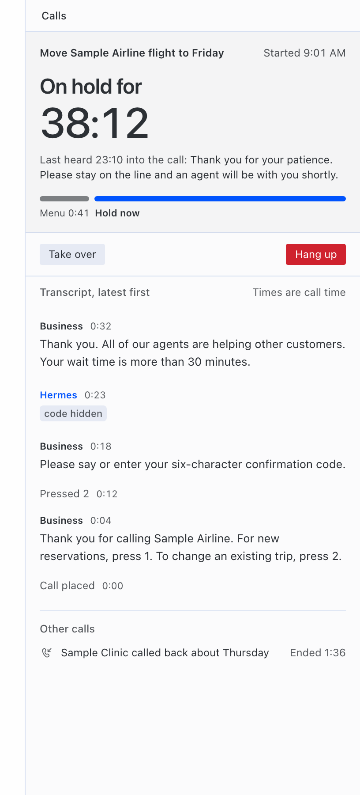
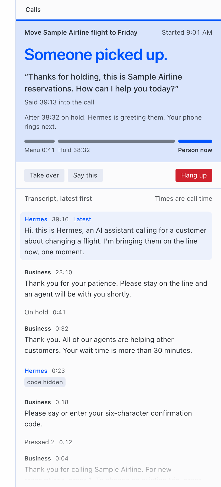
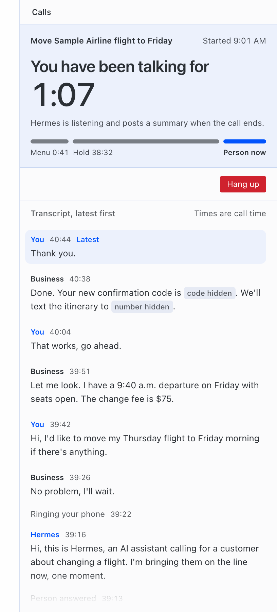
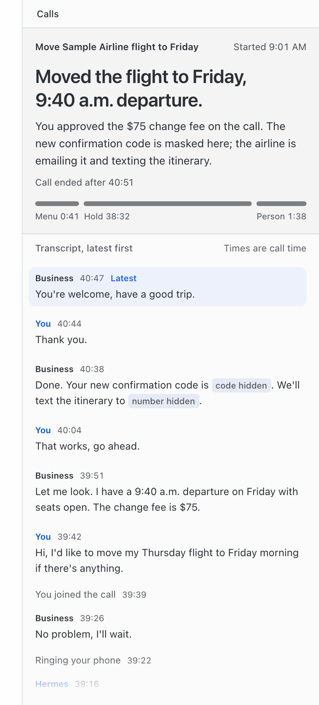

# Draft PR for NousResearch/hermes-agent. NOT SUBMITTED.

Can approved opening it (MIT-018). Owner, repo and maintainer are filled (`uzay-eth`). The only `FILL` left is the
release commit: at push, replace every `FILL-40-HEX-COMMIT-SHA` (catalog entry, screenshot URLs) and paste the
validation output at that commit. Re-check every number below against the release commit.

Format followed (from https://hermes-agent.nousresearch.com/docs/developer-guide/plugins/catalog-submission, read
2026-11-05): "Add one file, `plugin-catalog/<name>.yaml`" and "In the PR description, say what the plugin does,
which Hermes surfaces it uses, and everything rule 13 asks you to disclose. Add screenshots for anything with a UI."

---

**Title:** plugin-catalog: add hermes-line (phone calls with hold, bridge-in and approved SMS codes)

## What it does

Hermes Line gives Hermes a phone line on the user's own Twilio account. The user asks Hermes to call a business
and approves the call with `/line approve`. Hermes dials, says it is an AI assistant, presses menu keys, waits on
hold without talking, answers a business's automated assistant only with fixed routing phrases ("Representative.",
"Agent.", "Speak to an agent."), and when a person answers it either rings the user's phone and bridges them in, or finishes
the task itself with the user's own Hermes memory and tools. A summary goes back to the chat that asked for the
call. A Desktop pane shows the live call (state, time on hold, masked transcript) with Take over, Say this and Hang
up. On a restricted task the owner's phone rings only after a clear yes to "Am I speaking with a live person?" (or after
two human-like but unclear replies, so the owner judges), and
every fixed line waits for 1.2 seconds of quiet so Hermes does not talk over the business. With an Android phone on
USB or wireless debugging, an SMS verification code can be sent into the call as key tones or speech, after
the user approves which code goes to which call; the model never sees the code. Optional owner line mode lets
the user call their own line, key a PIN and ask Hermes to call a business; it is off unless a PIN is set and is experimental
(see "Tested live").

Adds `plugin-catalog/hermes-line.yaml` (draft in the plugin repo: `docs/release/catalog-entry.yaml`).

## Hermes surfaces used

- `ctx.register_tool` (11 tools, all declared), `ctx.register_hook` (`transform_tool_result`,
  `transform_llm_output`, used to replace a released code with `[CODE]` in later tool results and replies),
  `ctx.register_command` (`/line`), `ctx.register_skill` (bundled `hermes-line` skill), `ctx.get_config`,
  `ctx.on_unload`, `ctx.ask_choice` (code approval, with a `/line confirm-code` fallback).
- `ctx.post_message` / `ctx.inject_message` to deliver the call summary to the originating chat.
- Secrets: `agent.secret_scope.get_secret` for the names in `requires_env` / `optional_env`.
- Desktop: one `panes` contribution in `desktop/plugin.js` (imports only `@hermes/plugin-sdk` and `react`),
  `ctx.rest`, `ctx.onEvent`; backend REST in `dashboard/plugin_api.py`; events through
  `hermes_cli.plugin_events.broadcast_plugin_event`.
- Each call's conversation is a Hermes session through the documented ACP adapter (`hermes acp`), so the call
  brain is the user's own Hermes. The viewer runs as `hermes --profile <call_profile> acp`. The in-call tools (press keys, finish, bring the
  owner in, and a new-call request that works only after the owner's PIN) reach that session as a session-scoped MCP server on loopback, passed in ACP `session/new` `mcpServers`.
- Missing hook we would ask for: ACP `session/new` cannot carry a toolset selection to the gateway's
  `session.create` `toolsets`, so the plugin bounds the call session's tools with a dedicated profile instead.

## Disclosures (rule 13)

- **Network, third parties:** Twilio (`api.twilio.com`; all call audio passes through Twilio; on the
  ConversationRelay path Twilio does speech-to-text and text-to-speech). xAI (`api.x.ai`), only if the user sets
  `XAI_API_KEY`: hold and menu audio to xAI speech-to-text, conversation audio to Grok Voice. The user's tunnel
  provider carries Twilio's webhooks and audio to the plugin. Masked call text goes to the user's Hermes model
  provider as a normal Hermes session.
- **Reads outside its own data:** the SMS inbox of a USB-attached Android phone via `adb shell content query`
  (read-only), when `sms_source: adb` (default; the phone is optional). Before each call, the call session's tool
  list through `hermes acp`.
- **Processes it starts:** `adb`; one `hermes acp` process per call, which starts the call profile's Hermes gateway
  (idle-exit) if it is not running.
- **Background service:** with `enabled: true` (default `false`), a call service in the Hermes process listening on
  `127.0.0.1:8788` (exposed by the user's tunnel) and on a loopback-only port for the in-call tools (per-call
  256-bit bearer token).
- **Stored data:** `plugin-data/hermes-line/line.db` (tasks, calls, masked transcripts, events, SHA-256 hashes of
  released code messages, owner-PIN failure counts and lockouts) and a 0600 webhook path secret file. No credentials
  are stored by the plugin; the optional owner PIN is a Hermes secret (`HERMES_LINE_OWNER_PIN`, `optional_env`) and is
  never passed to the model, transcripts, events or logs.
- **The call session holds only the call tools (rule 12).** Calls run in a dedicated Hermes profile
  (`call_profile`) with no ACP toolsets. Before every dial the plugin reads the session's tool list and refuses the
  call unless it holds only the deferred-tool bridge and the call tools. The `hermes acp` child never inherits `HERMES_YOLO_MODE`, `HERMES_IGNORE_RULES`, `HERMES_ACCEPT_HOOKS`,
  `HERMES_SAFE_MODE` or `HERMES_IGNORE_USER_CONFIG`, and the driver declines every permission request. Tested with
  a real `hermes acp` and gateway (fixture model) and `HERMES_YOLO_MODE=1` in the service's environment: an
  unrestricted profile was refused before dialling, the restricted one finished its call.
- **Phone safety defaults:** AI disclosure line on every outbound call (on by default); the plugin always sends
  `Record=false` to Twilio and has no recording feature; dialing only to an allowlist the user writes; every call
  needs the user's approval, which the model, tools and phone audio cannot give, also when the user turns the
  allowlist off; an exact-number block list; one call per line; quiet hours 21:00 to 08:00 in the user's time
  zone; emergency numbers, short codes, N11, premium (900, 976) and non-US numbers always refused (US geographic
  and toll-free numbers can be called); SMS codes released only with per-code consent bound to sender, time window
  and destination call, and delivered only into that call (no browser fill in this build).
- **Owner line mode (optional, off unless a PIN is set):** a call from the owner's number is only offered a keypad
  PIN; caller ID alone approves nothing. Wrong PINs count per line across calls and restarts (3 lock it for 15
  minutes, 10 in 24 hours lock it until `/line unlock-owner`). A call requested by phone is approved only when the
  caller keys digits of the number the plugin read back: the last four for the owner's own or an already approved
  number, otherwise the last seven; speech never approves. PIN tones pass through Twilio.
- **Speaking to automated assistants (restricted tasks):** until a person is detected, only fixed phrases chosen by
  rule are spoken, at most one every 8 seconds and 12 per call; requests for a name, number, code, date, card or
  identity get "Agent."; callback, payment and change offers get nothing. Keypad menus are answered only when every
  sentence matches an allowed greeting, hold line or option.
- **Verification codes come only from a carrier phone.** Twilio numbers filter one-time-code texts (error 30038).
- **No telemetry.**

## Validation

`hermes plugins validate --install-deps` (cold, throwaway `HERMES_HOME`): "Validation passed. Exit status: 0", no
plugin warning; every check from manifest to desktop surface is ✓. FILL: re-run at the pinned commit and paste the
output here.

Last cold run: see `tests/l1/evidence/validate.txt`. Offline tests on the release tree (2026-11-08): L1 571, L2 145,
L4 353 (2 skipped), L5 88 and L6 122 pass; L3 75 of 76 (the remaining test needs a local Hermes Desktop build).

## Tested live

As of 2026-11-08 (evidence in `evidence/trial/`, `docs/release/REPORT.md` and the plugin README status table):
- Five calls with the author's own phones: three outbound (80 s with a 39 s silence bug; 43 s after the fix; 64 s
  on the Grok path with one question to Hermes) and two inbound through Google Fi "Always forward" (92 s, 121 s;
  Twilio got the original caller in `From`, no `ForwardedFrom`; Fi's "press 1 to take this call" prompt answered).
- Four calls to Delta Air Lines reservations (toll-free, approved by the owner); no person reached on any run.
  Run 1 (68 s): Hermes stayed silent under the menu gate at Delta's automated assistant. Run 2 (57 s): a false
  "person" verdict rang the owner (no pickup) and the fallback question went to the bot. Run 3 (retry, 14 min 3 s):
  the assistant transferred the call to the real hold queue (23 minutes announced); Hermes spoke into the hold queue
  seven times and the call ended at a service restart; fixed offline before run 4. Run 4 (44 min 43 s): one "Agent."
  to the assistant, then Delta's real hold queue in silence (0 phrases spoken into hold, no false "person" verdict),
  ended at the trial's maximum call length.
- Three calls to Hilton Reservations (toll-free, approved by the owner) on 2026-11-08: real keypad menus (the menu
  gate pressed nothing) and default transfers; real agents answered three times in two of the calls, and the
  live-person check missed every time, so the owner was never rung and no bridge happened. Fixed offline (round
  43c), not yet re-proven live.
- Twilio caller-ID verification of the Fi number; an SMS code read on a Pixel 10 Pro XL with the code masked.
- The Desktop pane inside a real Hermes Desktop (sandbox install, sample data).

Not yet shown live: detecting a real agent, ringing the owner for a real person, bridging, pressing a key on a real
menu, a business calling back, codes into a live call, owner line mode with the PIN, and barge-in on the Grok path. Owner line mode passed a scoped security review (R1b delta
35) for one attended trial calling the owner's own other line; two Medium limits remain for wider use. The plugin README has a status table with the evidence
for each item.

## Screenshots

Offline harness renders with sample data (the same four as the catalog entry), pinned to the release commit:

## Checklist

- [ ] One file added: `plugin-catalog/hermes-line.yaml`
- [ ] `sha` is the full 40-character release commit; `version: "0.1.0"` matches `plugin.yaml`
- [ ] `requires_hermes: ">=0.22.5"` in the entry and in `plugin.yaml`
- [ ] `capabilities` match registrations (11 tools, 2 hooks, 3 env vars)
- [ ] Validation output at the pinned commit pasted above
- [ ] Submitted from the owner's account (rule 5)
